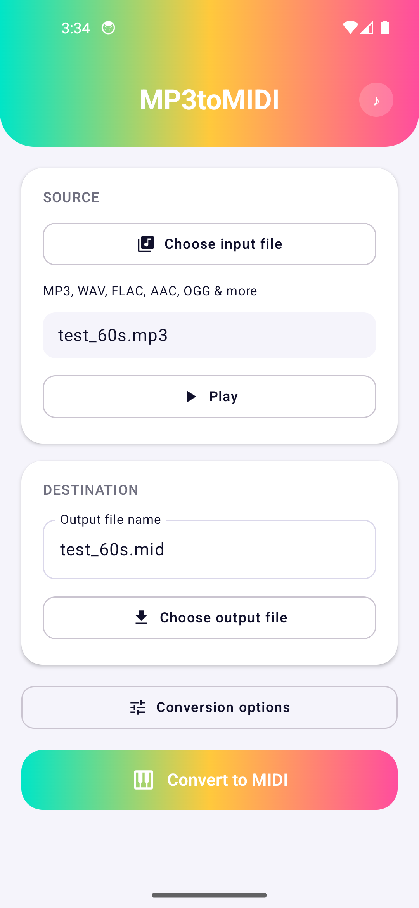
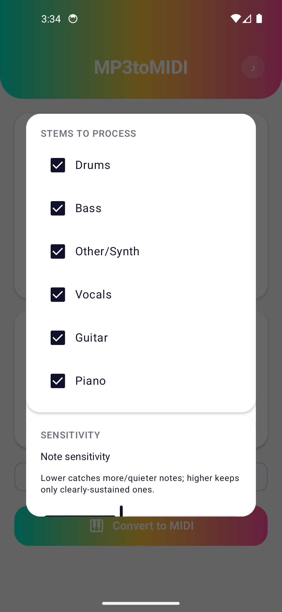
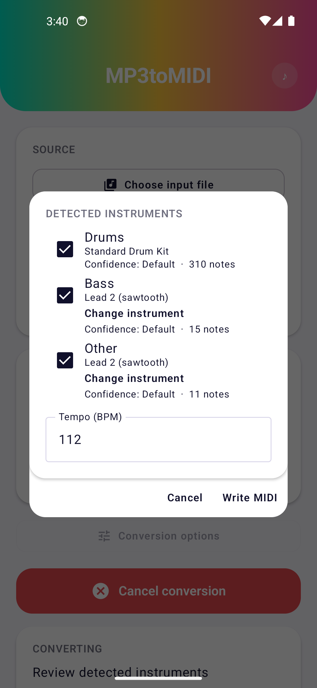
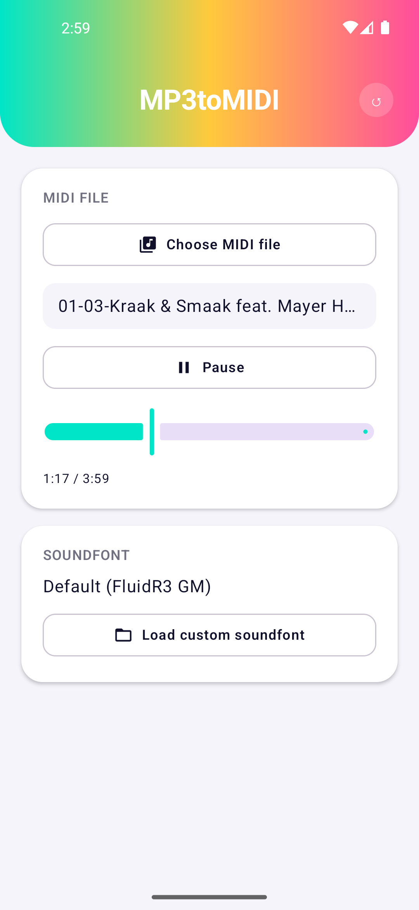

# MP3toMIDI

MP3toMIDI is a "proof of concept" idea I had where I wondered whether I could automate splitting stems from a real song and turning that into a decent MIDI file.
So far the results are.. interesting, but nowhere near good. The files tend to be too busy to be enjoyable but the original song is usually recognisable.

It splits the song into six stems with Demucs, finds pitched notes and drum hits, then writes a MIDI file. It runs on Android 8.1 or newer after downloading the models and a soundfont. A conversion can take ten minutes or more on a midrange phone.

You can try it as it is, but expect plenty of wrong and extra notes.

Cheers

   

## What it does

- Splits drums, bass, vocals, guitar, piano and other sounds with Demucs `htdemucs_6s`.
- Finds pitched notes and chords with Spotify's Basic Pitch, and identifies kick, snare, hi-hat and crash hits.
- Estimates the tempo from the drums and the instrument from YAMNet, note shapes or a default for the stem.
- Reads MP3, WAV, FLAC, AAC, OGG, Opus and other formats Android can play.
- Lets you choose stems, detection sensitivity and output as one track, a track per instrument or separate files.
- Shows the detected instruments, confidence and note counts before writing. You can remove stems, change instruments and fix the tempo.
- Continues conversions in the background and can resume after the app is killed. Cancel removes the unfinished output.
- Plays any MIDI file through the default soundfont or your own `.sf2`.
- Works offline once the models and soundfont have downloaded. Basic Pitch comes with the app.

## Installing

The easiest way to install MP3toMIDI and keep it up to date is through my F-Droid repo:

[https://hunke.ws/fdroid/repo](https://hunke.ws/fdroid/repo?fingerprint=80438B253C257BCCE05CDCB9E3AC9B6174C2250659962B14FCBE7F32FD42D53E)

Then search for MP3toMIDI in F-Droid. When a new version comes out, F-Droid will offer it as an update.

You can also download the APK from the [Releases](https://github.com/roge-rm/MP3toMIDI/releases)
page and sideload it.

## Requirements

- Android Studio (recent stable), with the NDK and CMake 4.1.2 for the audio engine. It'll offer
  to install them if they're missing.
- If you build from the command line, point `JAVA_HOME` at Android Studio's JDK:
  ```
  export JAVA_HOME=/path/to/android-studio/jbr
  ```
- minSdk 27 / targetSdk 37.
- A phone or emulator with a few GB of free RAM. Splitting the stems peaks around 750 MB.
- Internet the first time you convert, for Demucs (~235MB) and YAMNet (~16MB), and the first time
  you open the player, for the default soundfont (~148MB). Not needed after that.

## Building and testing

```
./gradlew assembleDebug        # build the debug APK
./gradlew testDebugUnitTest    # run the unit tests
```

Release builds aren't signed unless you give it a keystore. Put your details in
`local.properties` (it never gets committed):

```
mp3tomidi.release.storeFile=/path/to/your.keystore
mp3tomidi.release.storePassword=...
mp3tomidi.release.keyAlias=...
mp3tomidi.release.keyPassword=...
```

then run `./gradlew assembleRelease`.

## Architecture

- `convert/` - `ConversionPipeline` runs the split, find notes and pick instruments steps
  based on `ConversionOptions`. It runs as two `WorkManager` jobs: `AnalysisWorker` does the
  listening and saves what it found to disk (`IntermediateResultStore`), `ReviewDialog` shows
  it to you, and once you confirm (`ReviewSelections`) `WriteWorker` loads it back, applies your
  changes and writes the MIDI. Splitting it in two is what makes the review step possible, and
  what lets a conversion survive the app being killed.
- `convert/stages/` - the steps themselves, each one swappable:
  - `DemucsStemSeparator` - runs `htdemucs_6s` over the song in overlapping chunks, blends them
    back together, and writes the stems to disk as it goes instead of holding them all in memory.
  - `BasicPitchTranscriber` / `CompositeNoteTranscriber` - finds the notes in pitched stems.
  - `DrumOnsetDetector` + `DrumHitClassifier` - finds the drum hits and works out what each one is.
  - `TempoDetector` - the tempo, from the drum hits.
  - `TimbreClassifier` (YAMNet), then `NoteEnvelopeClassifier`, then `DemucsSourceClassifier` -
    the three tries at picking an instrument for each stem, in order.
- `midi/` - `MidiFileWriter` writes standard MIDI files from scratch (format 0 for one track,
  format 1 for a track per instrument), and `MidiFileParser` reads them back for the player.
- `player/` - `Mp3Player` previews the source song, `MidiPlayer` plays a MIDI file through
  `SoundEngine` (instrument changes, seeking, pause).
- `audio/` + `cpp/` - `SoundEngine`/`NativeSoundEngine` on the Kotlin side, and an Oboe +
  TinySoundFont engine (`native_sound_engine.cpp`) on the native side, borrowed from
  [ScaleInKey](https://github.com/roge-rm/ScaleInKey). Notes get passed through a lock-free
  queue so Kotlin never gets in the way of the audio thread.
- `util/` - `AudioDecoder` (turns any song Android can play into raw audio), `ModelProvider`
  (downloads and checks the models and the soundfont), `PcmUtils`.
- `ui/` - the Compose screens (`MainScreen`, `PlayScreen`, `MainViewModel`), the options and
  review dialogs, and the theme. The button in the header (`AppHeader`) switches between
  converting and playing.
- `tools/` - Python scripts (not part of the app) that export each model to ONNX and check it
  against the original. Each folder has its own README with the details.

## Attribution

The app uses these models and libraries:

- [Demucs](https://github.com/facebookresearch/demucs) (`htdemucs_6s`) by Meta/Facebook
  Research, MIT License. Exported to ONNX to run on the phone, see
  `tools/demucs_export/README.md`.
- [Basic Pitch](https://github.com/spotify/basic-pitch) by Spotify, Apache License 2.0.
  Comes with the app (it's only ~230KB), see `tools/basic_pitch_export/README.md`.
- [YAMNet](https://tfhub.dev/google/yamnet/1) by Google, Apache License 2.0, using the
  [AudioSet](https://research.google.com/audioset/) categories. The ONNX version is from
  `zeropointnine/yamnet-onnx` on Hugging Face, checked against the original, see
  `tools/yamnet_export/README.md`.
- [ONNX Runtime Mobile](https://onnxruntime.ai/) by Microsoft, MIT License. Runs all three
  models.
- [FluidR3 GM](https://member.keymusician.com/Member/FluidR3_GM/) soundfont by Frank Wen, MIT
  License. The player's default soundfont, downloaded the first time you use it.
- [TinySoundFont](https://github.com/schellingb/TinySoundFont) by Bernhard Schelling, MIT
  License. Included in `app/src/main/cpp/tsf.h`.
- [Oboe](https://github.com/google/oboe) by Google, Apache License 2.0. Low-latency audio for
  the player.
- Jetpack Compose, WorkManager, Media3 and the rest of AndroidX and Kotlin.

## Licence

MIT, see [LICENSE](LICENSE).

Disclaimer: I am not a great programmer and this was made using Claude Opus 5.0/5.5
